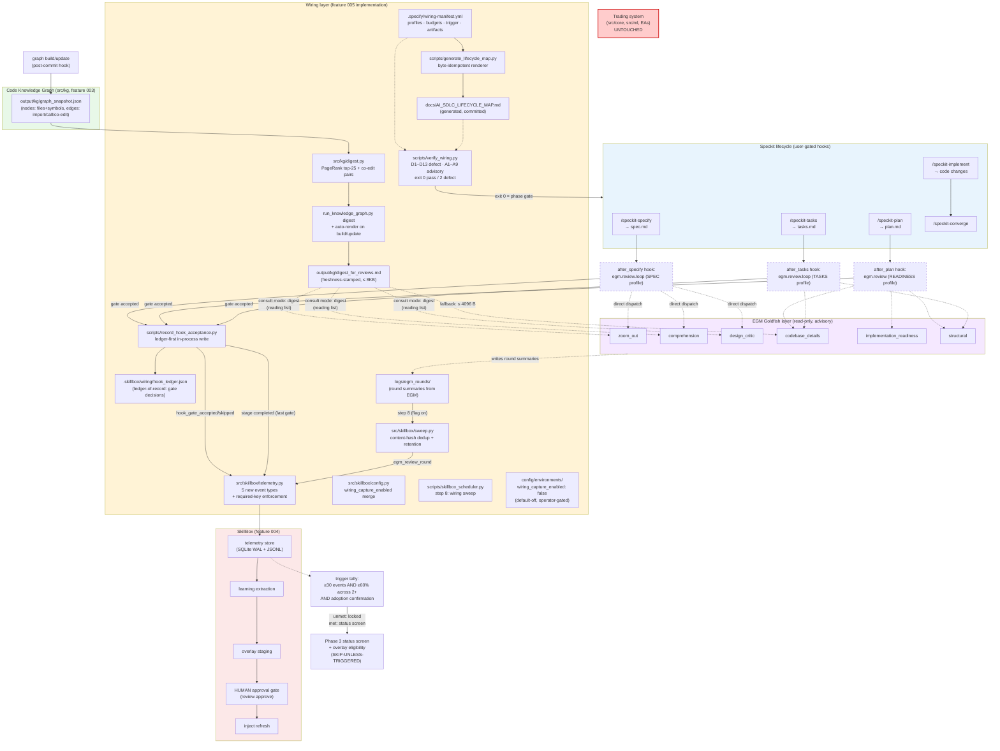

# AI-SDLC Wiring: Implementation Flow (Feature 005)

This diagram shows what was actually implemented and wired together in this session — the complete flow from the maintainer's feature idea through to the learning loop's data-gated Phase 3.

## What the diagram shows

**Structure** (the four systems):

- **Speckit** (blue): the spec-driven lifecycle with user-gated hooks. Every hook is optional; accepting a gate runs the recording command.
- **EGM** (purple): the read-only reviewer layer. Goldfish never execute commands, never parse internal graph files, and never feed learnings back into their own context.
- **Wiring layer** (yellow): what we built — manifest, map, verifier, ledger, recorder, digest, sweep, telemetry types, capture flag. All repo-owned, all fail-soft.
- **KG** (green): the graph + its new digest artifact, auto-rendered at every build/update.
- **SkillBox** (red/pink): the learning runtime the capture contract feeds.

**The four information flows**:

1. **Digest flow** (KG → EGM): graph build/update auto-renders `digest_for_reviews.md`; reviewers read it as a plain file (no execution). Stale → labeled, never fails.
2. **Recording flow** (Speckit hooks → SkillBox): gate decisions write ledger-first via the recording command; a scheduled sweep converts EGM round summaries into review-round events. Inert when the flag is off.
3. **Learning flow** (SkillBox → itself): events → learnings → pending overlays → HUMAN approval → inject refresh → copilot-instructions.md. The only loop that changes behavior.
4. **Gate flow** (verifier → speckit): verifier exit 0 gates every wiring phase; the landmine (`auto_execute_hooks`) is pinned off and machine-checked.

**Safety boundary (red)**: the trading system sits outside all of this — no wiring component touches it, no advisory gates it, and the verifier asserts the trading-path isolation.

**Phase 3 discipline**: the trigger tally (≥30 events, ≥60% acceptance across 2+ features) AND the recorded maintainer confirmation both gate Phase 3. If either is unmet, nothing below the dashed line is built.
